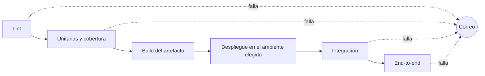

<h1>Proyecto final</h1>

<b>Un sistema, tres capas de pruebas y un pipeline que avisa cuando algo se rompe.</b>

<a href="#fechas">Fechas</a> &nbsp;|&nbsp;
<a href="#el-sistema">El sistema</a> &nbsp;|&nbsp;
<a href="#pruebas">Pruebas</a> &nbsp;|&nbsp;
<a href="#pipeline">Pipeline</a> &nbsp;|&nbsp;
<a href="#justificacion">Justificación</a> &nbsp;|&nbsp;
<a href="#demo">Demo</a> &nbsp;|&nbsp;
<a href="#entrega">Entrega</a>

---

Cada grupo toma un sistema web con API, propio o de un repositorio que ya existe, y le arma lo que vimos en el curso: pruebas unitarias con cobertura como puerta de calidad, pruebas de integración de caja negra, pruebas end-to-end con Page Object Model y un pipeline que corre todo eso. En la demo el grupo rompe una prueba, el pipeline queda en rojo y llega un correo. Cada decisión lleva su justificación con la teoría del curso.

## Fechas

| Qué | Cuándo |
|---|---|
| Sesión opcional de dudas | Jue 5 nov, en el horario de clase |
| Tag de entrega y archivo en MIU | Mar 10 nov, 14:29 |
| Demos | Mar 10 y Jue 12 nov, en clase, en un orden que se sortea y se avisa por WhatsApp |

Todos los integrantes escriben pruebas y tocan el pipeline, y el historial del repositorio lo muestra. Se califica:

| Qué | Mínimo |
|---|---|
| Commits de cada integrante en el historial del commit entregado | 3 |
| Autor de cada commit | el nombre y el correo de git de quien lo escribió |

Un integrante con 2 commits o menos no cumple, aunque el resto del grupo sí. En la demo el catedrático escoge un commit y lo explica quien figura como autor.

## El sistema

Sirve un repositorio propio, uno de código abierto o uno nuevo. El repositorio entregado es público. Si viene de otro lado, el README dice de dónde y con qué licencia, y las pruebas y el pipeline son del grupo.

| Stack | Pruebas |
|---|---|
| Interfaz web | end-to-end |
| API HTTP | integración (componente) |

Un sistema nuevo cabe en 3 a 5 endpoints y 2 o 3 pantallas.

## Pruebas

| Capa | Qué se pide |
|---|---|
| Unitarias | Pruebas de la lógica de negocio con cobertura medida sobre los módulos de negocio. Si la cobertura baja del umbral, el pipeline se detiene. El grupo decide el porcentaje del umbral y lo justifica en `DECISIONES.md`, junto con los módulos que quedaron fuera. |
| Integración | Pruebas de caja negra contra la API en ejecución, diseñadas con partición de equivalencia, valores límite y una tabla de decisión. Cubren cada partición, los dos lados de cada límite y cada regla de la tabla. Cada caso dice qué técnica lo produjo y qué cubre. La herramienta es libre. |
| End-to-end | Playwright (preferido) o Selenium, con Page Object Model. Tres recorridos de usuario como mínimo, uno marcado como smoke. Aplican dos principios SOLID como mínimo, cada uno con la clase donde está y el problema que evita. Recibir una dependencia por constructor no cuenta, por sí solo, como principio. |

## Pipeline

Jenkins, GitHub Actions u otro sistema de CI. El pipeline vive en el repositorio. En la interfaz del CI solo se configuran a mano el job que apunta al repositorio, los plugins y los secretos. El CI pide usuario y contraseña o solo escucha en la máquina del grupo; abierto en la red del campus, cualquiera controla esa máquina.

Un orden posible:

1. Lint y unitarias van antes del build, e integración y end-to-end corren contra una instancia desplegada. Cada una tiene su propia etapa. El resto del orden lo decide el grupo y lo justifica.
2. Si una etapa falla, el build queda en rojo y las siguientes no corren. Una etapa colgada termina sola al pasar un tiempo máximo, y ese caso también manda el correo del punto 6.
3. El artefacto se construye una sola vez por build, con el SHA del commit o una versión como identificador. La instancia desplegada responde ese identificador por HTTP, el log lo muestra y el build falla si no coincide con el del commit.
4. Al lanzarlo se elige el **ambiente**. Hay dos como mínimo, cada uno es otra instancia del sistema con el mismo artefacto y otra configuración. Las dos pueden correr en la misma máquina del CI, en puertos distintos. El log muestra la URL probada y la respuesta de esa instancia con su ambiente y su versión; la respuesta la da el sistema, no el pipeline.
5. Al lanzarlo también se eligen **dos parámetros más** como mínimo, cada uno con un efecto que se ve en el log o en los reportes, y uno de ellos cambia qué pruebas corren o en qué navegador, como la suite (smoke o regresión) o el navegador de las end-to-end. Un parámetro que solo sirve para provocar una falla no cuenta.
6. Cuando falla, manda un **correo** con el número de build, el commit, el ambiente, la etapa que falló y el enlace al log (un enlace a localhost vale). Los destinatarios se cambian al lanzarlo y tienen un valor por defecto.
7. El pipeline lee el servidor de correo y sus credenciales de **variables de entorno**, como el CI las inyecte. La configuración global de correo del CI no cuenta. El usuario y la contraseña quedan fuera del repositorio y del historial, y la contraseña no sale en el log, ni aunque el pipeline imprima su entorno. El servidor y el puerto sí pueden ir en el README.
8. Cada commit en la rama principal dispara un build con los valores por defecto.

## Justificación

`DECISIONES.md` lleva una tabla por cada decisión importante. Como mínimo: el umbral de cobertura, cómo se armó cada capa de pruebas, el orden de las etapas, qué quedó como parámetro y qué quedó fijo, y el diseño de los page objects.

| Campo | Contenido |
|---|---|
| Decisión | qué se hizo |
| Alternativa | qué otra opción había y por qué no |
| Concepto | el concepto del curso por su nombre: pirámide de pruebas, shift-left, gate, flaky test, config as code o un principio SOLID |
| Evidencia | la prueba, la clase o el número de build donde se ve |
| Fuente | referencia IEEE, si la decisión sale de un libro, un artículo o documentación |

Se vale usar IA. Al final de `DECISIONES.md` van tres sugerencias de IA como mínimo que el grupo aceptó o rechazó, con la razón y la prueba o el build que la respalda.

## Demo

15 minutos de demo y 5 de preguntas. Al empezar, el CI está accesible y el correo configurado. La demo parte del commit entregado, y el único commit nuevo es el que rompe una prueba, que no se califica. Para que todo quepa, un build tarda menos de 3 minutos del lanzamiento al resultado, con las dependencias en caché; es una meta de tiempo, no un punto de la nota.

| # | Qué se ve |
|---|---|
| 1 | Un build verde ya terminado del commit entregado, con sus etapas |
| 2 | El pipeline contra los dos ambientes, lanzado en vivo con parámetros, con la diferencia a la vista |
| 3 | Un cambio al código del sistema, no a las pruebas, que rompe una prueba solo en la capa que escoge el catedrático (el grupo trae uno listo por capa). El grupo lo empuja y lanza el build a mano con la dirección que da el catedrático como destinatario: el build queda en rojo en esa etapa y las siguientes no corren. El build automático que dispara ese push no cuenta |
| 4 | El correo de ese build, que llega al buzón de esa dirección. Un servidor de correo local que no entrega a buzones reales no cuenta |
| 5 | Preguntas: el catedrático escoge a un integrante, un commit y una decisión de `DECISIONES.md` |

## Dudas

Las dudas van por WhatsApp al catedrático en cualquier momento del proyecto, además de la sesión del Jue 5 nov.

## Entrega

Dos cosas antes del Mar 10 nov a las 14:29, para los dos días de demo:

1. Un tag en el repositorio público.
2. Un archivo de texto en MIU con el enlace al repositorio, el nombre del tag y el SHA completo del commit al que apunta (los 40 caracteres del commit, no del objeto del tag). Cuenta la hora de envío en MIU; un borrador no cuenta.

Se califica el commit cuyo SHA está en MIU. Un tag movido, un commit posterior o un historial reescrito no cuentan, y si ese SHA ya no existe al calificar, no hay entrega. El pipeline se califica en la demo en vivo; `evidencia/` es el respaldo.

| Archivo | Contenido |
|---|---|
| `README.md` | qué es el sistema, cómo levantarlo, los ambientes y los parámetros |
| `DECISIONES.md` | la justificación |
| `EVIDENCIA.md` | los builds verde, rojo y verde otra vez, cada uno con el SHA de su commit; un build por ambiente; un build detenido por la puerta de cobertura; la etapa y la prueba que fallaron en el rojo; y cuántas pruebas tiene cada capa |
| `evidencia/` | capturas de las etapas de esos builds, de la revisión de git en cada uno y del correo con destinatarios y número de build |

Los números de build, los SHA y el correo coinciden entre sí, y esos SHA están en el historial del commit entregado.
